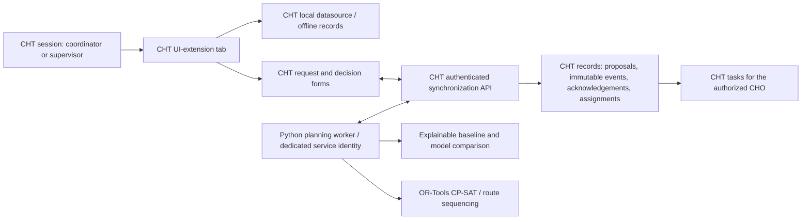

# Outreach Intelligence inside CareLink Reach

Status: fictional-data development prototype on the installed CHT 5.3.0 source archive. CHT is the only normal user-facing application. The Flutter/Python CareLink product is separate and unchanged.

## One application and one source of truth

The extension **does not call a Python localhost URL**. A coordinator's request is a normal CHT report. It synchronizes using the existing CHT session. The worker polls the authenticated CHT API and publishes a proposal back through that API. Decisions follow the same route. There is no second user login or operational approval database.

The worker uses `/medic/_all_docs` and the authenticated CouchDB-compatible document API exposed by **CHT on port 5988**, not direct database access on 5984. The separate administrative installation of `_design/carelink-authority` uses CouchDB's supported validation mechanism; it is a custom maintenance responsibility, not an official CHT configuration key or a patch to CHT's bundled design documents.

## Verified extension points

- CHT 5.3 `header_tab` UI extension, uploaded with `cht-conf upload-ui-extensions`.
- `roles` limits the extension to coordinators and supervisors. CHT replication limits the underlying offline data.
- `this.inputs.config` supplies the demo facility, staff and vehicle catalogue; `userContactSummary` supplies the signed-in contact context.
- `this.cht.v1.report.getUuidsByForms` and `getByIds` read the user's local datasource. No browser database is opened directly.
- The extension refreshes local records every five seconds, responds to network events, and removes its timer/listeners on disconnection. Unchanged records do not redraw the screen.
- Request and review buttons open CHT forms/tasks. CHT's task page requires `can_edit` as well as `can_view_tasks`; supervisors receive that prerequisite, while form-specific permissions and server validation retain the restrictions.

References: [CHT UI extensions](https://docs.communityhealthtoolkit.org/building/reference/ui-extensions/), [CHT report datasource](https://docs.communityhealthtoolkit.org/cht-datasource/interfaces/Report.v1.Datasource.html). Installed implementation verified in `webapp/src/ts/services/ui-extensions.service.ts`, `modules/ui-extensions/`, and `shared-libs/cht-datasource/` of the adjacent Core archive.

## Records and authority

| Record | Writer | Meaning |
|---|---|---|
| `carelink_oi_request` | Coordinator or supervisor | Request optimization; actor stamped with authenticated CHT username |
| `carelink_oi_proposal` | Planning service | Versioned inputs, real solver result, explanation, fairness and alternatives |
| `carelink_oi_review` | Author submits; supervisor reviews/decides | Append-only action naming the exact predecessor |
| `carelink_oi_ack` | Planning service only | Accepted, rejected or conflicting action; authoritative server state |
| `carelink_oi_assignment` | Planning service only | A planned outreach-day assignment after durable server approval |
| `carelink_oi_outreach_day` | CHO | Operational outcome documentation; not proof of patient treatment |
| `carelink_oi_demand` | Planning service only | Append-only aggregate snapshot, keyed by meaningful input hash and model version |

`authority/validate_doc_update.js` enforces role-specific writes, immutable plan events, authenticated actor names and service-only records. The service account cannot write unrelated records. Coordinators cannot submit review/approval/rejection actions. The worker enforces predecessor order, separation of duties, reviewer identity, feasibility and existing assignments.

Accepted state is reconstructed from predecessor links, not client timestamps or tied server timestamps. Two decisions on the same current predecessor in one processing snapshot both receive conflict acknowledgements. If the first decision was already accepted before the second arrived, the second is stale and rejected. Neither case applies the action twice.

Approval acknowledgement is durable **before** assignment documents are issued. Later cycles repair missing assignments after an interruption. Stable IDs prevent replay duplicates. In-memory reservations include assignments created earlier in the same cycle. An OS lock prevents two worker processes for the same facility on one host. Multi-host deployment still requires a singleton leader; these records are not a distributed transaction.

## Inputs and engines

`lib/oi-export.js` and `carelink_oi.data_adapter` retain the existing community aggregation and whitelist. The worker scopes inputs to its configured facility before aggregation and ignores plan requests for other facilities. Per-person measurements, household identifiers, phone numbers and clinical notes are excluded from model inputs. Danger-sign review items remain outside routine optimization.

The operational predictor remains the transparent baseline. StatsForecast intermittent-demand candidates and MLForecast are evaluated separately; ML is experimental. `model_comparison.py` freezes baseline selection before the first evaluated target. Missing weeks are not true zeros and are never scored. See `OUTREACH_INTELLIGENCE_MODEL_EVALUATION.md` for measured results.

The existing CP-SAT engine remains Python. OR-Tools routing sequences larger trip options; tiny routes are enumerated exactly. Staff/community eligibility, travel, service time, working hours, transport capacity and fairness remain constraints or declared policy. Existing approved capacity is retained in confirmed inputs. Recommendations cannot overwrite confirmed assignment records.

## Deployment and transport

For a deployment, serve CHT through its normal HTTPS origin. Android connects only to that origin. Run the worker on trusted server infrastructure with a restricted service secret, outbound HTTPS to the same CHT API, certificate verification, a protected credential file and one active worker per facility. There is no new public Python endpoint and no CORS/second-cookie integration to configure.

The prototype helpers intentionally accept only localhost. Remote deployment needs reviewed configuration and service-account read minimization: the present online service account can read the CHT dataset before application-level facility filtering. A production system must not equate that filter with a database-level read boundary.

The old `carelink_oi.server` website and file-based approval store are retained for optional developer regression use only. Historical files are preserved; old approvals are not silently imported as CHT approvals. Once the CHT flow is verified, stop the duplicate server in the normal workflow. Do not deploy it alongside the CHT planner as a second operational authority.
